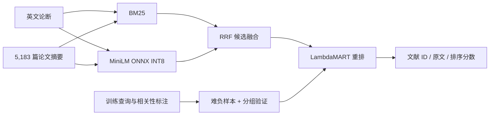

# EvidenceForge · 科学文献检索与学习排序

面向 NLP 算法实践的可复现实验项目：给定英文研究论断，在完整 SciFact 论文摘要库中检索相关文献，比较稀疏检索、神经语义检索、融合召回与监督学习排序。

项目包含真实公开数据、难负样本挖掘、训练内分组验证、排序消融、逐查询评测、误差分析、命令行与 FastAPI 服务。神经编码器保持冻结；训练的是 LambdaMART 排序模型。检索相关性不能判断论断真假，也不代表文献支持该论断。



## 运行

Python 3.11–3.13，建议 3.12。支持 CPU，不需要 API Key 或付费服务。首次运行需要联网下载公开语料与固定版本的模型；后续复用本地缓存。

```bash
python -m venv .venv
# Linux / macOS
source .venv/bin/activate
# Windows PowerShell 使用 .\.venv\Scripts\Activate.ps1
pip install -e ".[dev]"
evidenceforge download
evidenceforge index
evidenceforge experiment --output-dir results/scifact
evidenceforge search "Vitamin D deficiency is associated with cardiovascular disease." --method ltr
evidenceforge serve
```

在浏览器访问 `http://127.0.0.1:8000/docs` 可交互调用 API。首次模型下载/索引需要时间；索引完成后再启动服务。

```bash
curl -X POST http://127.0.0.1:8000/search \
  -H "Content-Type: application/json" \
  -d '{"query":"Vitamin D deficiency is associated with cardiovascular disease.","method":"rrf","top_k":5}'
```

只体验词法检索时，运行 `evidenceforge index --lexical-only` 与 `evidenceforge search "your query" --method bm25`。此模式仍需要数据，但不下载神经模型。

全局路径参数放在子命令之前，例如：

```bash
evidenceforge --data-dir data/scifact --cache-dir cache --threads 2 experiment --output-dir results/scifact
```

复现本仓库记录的版本时，用 Python 3.12 执行 `pip install -c requirements.lock -e ".[dev]"`。锁文件不包含本机路径或模型权重。

## 实验协议

| 项目 | 设计 |
|---|---|
| 数据 | BEIR SciFact，完整 5,183 篇文献；809 个训练查询，300 个测试查询 |
| 稀疏基线 | BM25，确定性分词和分数并列排序 |
| 神经基线 | 固定版本 all-MiniLM-L6-v2；ONNX INT8；均值池化、L2 归一化、余弦检索 |
| 融合 | Reciprocal Rank Fusion |
| 可训练模型 | LightGBM LambdaMART，检索分数、排名和文本匹配特征 |
| 负样本 | RRF 前 50 候选中的非标注相关文献；仅训练时允许补入缺失的正样本 |
| 验证 | 仅在训练查询内部划分，按共享相关文献/规范化论断构建连通组，减少变体泄漏 |
| 测试 | 固定测试集；不注入正确文献、不用测试标签选参 |
| 消融 | 相同 RRF 候选池，仅移除重排器中的 dense 与 RRF 特征；不是端到端移除 dense |
| 指标 | nDCG@10、MRR@10、Recall@10/50、候选召回上限、配对 bootstrap 置信区间 |
| 工程 | 固定模型版本、下载校验、缓存身份检查、模型文本序列化、离线测试、请求边界限制 |

BEIR 的 `test` 对应原始 SciFact 的公开 `dev`，并非原始隐藏测试集。其相关性标注源于 cited document IDs；“相关文献”与“有标注支持/反驳证据的文献”并不等价。详见 [数据说明](docs/DATA_CARD.md)。

## 实测结果

完整运行后，`results/scifact/report.json` 记录实际指标、训练选择和运行元数据，其他同目录文件保存逐查询结果、失败案例与 TREC 排名。结果以实际输出为准，不预设学习排序一定超过基线。

结果表将在本次完整基准运行后补入。任何尚未实测的能力都不作为已完成的性能结论。

## 代码入口

```text
src/evidenceforge/
  data.py          # 校验与加载 BEIR 数据
  neural.py        # 固定版本 ONNX 编码器
  retrieval.py     # BM25 / dense / RRF
  ranker.py        # 特征、难负样本、分组验证、LambdaMART
  evaluation.py    # 指标、bootstrap
  experiment.py    # 完整实验与报告
  cli.py           # 可复现命令行
  api.py           # FastAPI，使用相同检索/排序代码
tests/             # 小型合成数据仅用于离线正确性测试
docs/              # 数据、实验方法与面试材料
```

```bash
pytest -q
ruff check src tests
python scripts/verify_results.py --help
```

CI 在 Linux Python 3.11/3.12 上运行离线测试；完整基准需要单独运行。Dockerfile 提供服务打包入口，运行时将本地 `data/`、`cache/`、`results/` 所在目录挂载到 `/artifacts`。本地 API 默认只绑定回环地址；开放公网需要另行配置认证和部署设施。

`scripts/verify_results.py` 使用独立的标准库实现，从保存的 TREC 排名与相关性标注重新计算指标，检查报告是否一致，不需要重新训练模型。

## 简历与面试

- [实验方法与边界](docs/METHODOLOGY.zh-CN.md)
- [技术取舍、面试问题与简历模板](docs/INTERVIEW.zh-CN.md)
- [数据来源、标注语义与许可证](docs/DATA_CARD.md)

这是有公开数据实验依据的算法工程项目；不要表述为已经上线服务真实用户、训练大模型，或取得未经测量的线上收益。理解并能复现代码、实验和失败原因后，再在简历中描述自己的实际贡献。

## 来源与许可证

项目原创代码采用 MIT。数据和模型保持各自许可证，不随本仓库重新授权；原始语料、模型权重与缓存不提交 Git。

- [BEIR](https://github.com/beir-cellar/beir) / [BEIR paper](https://arxiv.org/abs/2104.08663)
- [SciFact 原始项目](https://github.com/allenai/scifact) / [数据许可证](https://github.com/allenai/scifact/blob/master/LICENSE.md)
- [MiniLM 模型卡](https://huggingface.co/sentence-transformers/all-MiniLM-L6-v2)
- [LightGBM LambdaRank 参数](https://lightgbm.readthedocs.io/en/stable/Parameters.html)
