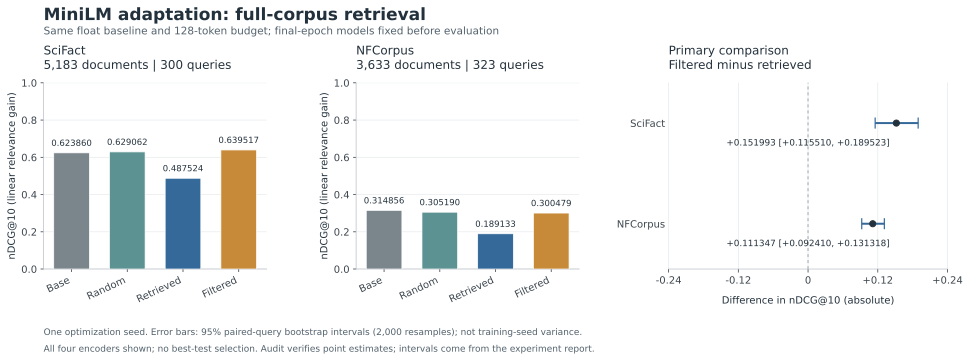
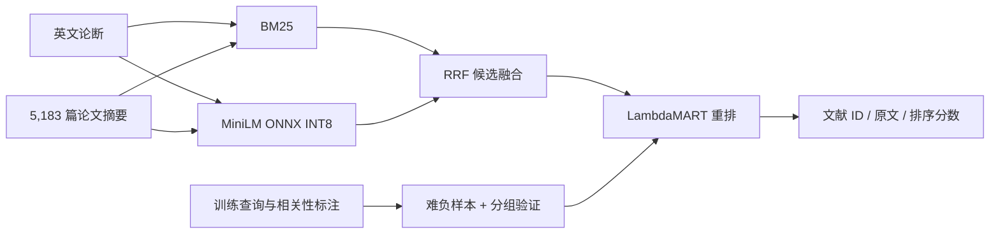

# EvidenceForge · 科学文献检索、负例采样与神经适配

[](https://github.com/chendi-Shi/evidenceforge-nlp/actions/workflows/ci.yml)

面向 NLP 算法实践的可复现实验项目：给定英文研究论断，在完整 SciFact 论文摘要库中检索相关文献，比较稀疏检索、神经语义检索、融合召回与监督学习排序。

项目包含真实公开数据、难负样本挖掘、训练内分组验证、排序消融、逐查询评测、误差分析、命令行与 FastAPI 服务。v1 训练 LambdaMART；v2 增加真实梯度更新的检索编码器 LoRA、负例采样对照、迁移评测，以及本地 Qwen3-Embedding 基线。检索相关性不能判断论断真假，也不代表文献支持该论断。

**v3 数据与实机预检已完成，完整结果待产出：** [资源受限的检索蒸馏与迁移退化](docs/DISTILLATION.zh-CN.md)。已固定独立 MS MARCO 来源的 12,000 条训练查询、1,000 条验证查询和 25,677 篇去重文档；Qwen3 教师向 MiniLM 最后两层的 354.9 万参数蒸馏，四组目标 × 三个 seed，之后在新的完整 SCIDOCS 上检验迁移收益与退化。预检只验证真实梯度与可运行性，尚无 v3 完整训练成绩；下方均为已经完成的 v1/v2 实验。

## v2：负例采样是否改善神经检索

**三组真实 LoRA 训练、两个数据集的完整评测和 Qwen 全库对照均已完成。** LoRA 的 32 项汇总指标及 Qwen 的 4 项指标通过独立复算。配置先于对应质量评测提交；所有最终适配器、梯度记录和排名均公开保存，模型计算只使用当前电脑。

| 组成 | 固定设计 |
|---|---|
| 训练 | MiniLM 最后 Transformer 层的 query/value LoRA，rank 8，12,288 个可训练参数；InfoNCE |
| 数据与预算 | SciFact 训练集内部按论断家族分组；647 条训练、162 条验证；三组均 2 epochs、648 次更新 |
| 三组对照 | 随机负例、检索难负例、按家族关系与相似度风险过滤的难负例；相同初始化和训练预算 |
| 主比较 | filtered − retrieved 的 nDCG@10；同时与相同浮点精度、128-token 长度的未适配编码器比较 |
| 迁移 | 完整 NFCorpus：3,633 篇文献、323 条测试查询；不在该数据集训练或选参 |
| 现代基线 | 官方 Qwen3-Embedding-0.6B Q8_0；已完成本机 CPU / Iris Xe Vulkan 性能验证及完整 SciFact 评测 |
| 可核查产物 | 固定协议、逐条负例决策、梯度记录、safetensors 适配器、TREC 排名和独立指标复算 |

相似度过滤只是未标注相关性的风险代理；移除高相似度样本也会改变负例难度。此实验不把“被过滤”视为已确认假负例，也不预设过滤一定有效。NFCorpus 与 SciFact 仍共享医学主题，迁移结论限定于任务和查询分布变化。

| nDCG@10 | SciFact：300 查询 | NFCorpus：323 查询 |
|---|---:|---:|
| 未适配 MiniLM FP32 / 128 tokens | 0.6239 | 0.3149 |
| 随机负例 LoRA | 0.6291 | 0.3052 |
| 检索难负例 LoRA | 0.4875 | 0.1891 |
| 风险过滤负例 LoRA | 0.6395 | 0.3005 |
| 冻结 Qwen3-Embedding-0.6B Q8_0 | 0.6752 | 未评测 |

Qwen 行是另行冻结的模型配置，其 tokenizer、查询指令、量化与参数量均不同，不属于三组 LoRA 的同初始化控制。它在 SciFact 的 MRR@10 / Recall@10 / Recall@50 为 `0.6410 / 0.8017 / 0.8967`。[完整 Qwen 报告](results/modern/scifact-full/report.json)与[独立复算](results/modern/scifact-full/independent_audit.json)均已保存。

**过滤缓解了难负例训练退化，但没有证明优于原始模型。** 预设的 filtered − retrieved 差值分别为 `+0.1520 [0.1155, 0.1895]` 和 `+0.1113 [0.0924, 0.1313]`。相对同配置未适配模型，过滤组在 SciFact 为 `+0.0157 [-0.0107, 0.0420]`，区间跨 0；NFCorpus 为 `−0.0144 [−0.0230, −0.0057]`，迁移仍有损失。区间为单次训练下的查询级配对 bootstrap，不估计训练随机性。



- [完整结果、敏感性检查与真实案例](docs/ADAPTATION_RESULTS.zh-CN.md)
- [机器可读报告](results/adaptation/report.json)、[独立复算](results/adaptation/independent_audit.json)、[逐查询分析](results/adaptation/analysis.json)
- [真实适配器 API 检查](results/adaptation/service_smoke.json)：三条预定查询的 dense 前五名与评测排名一致；另检查 RRF、模型身份和错误响应，属于集成检查，不是压测。

- [实验协议与边界](docs/ADAPTATION_PROTOCOL.zh-CN.md)
- [CPU 安装、训练、续跑与服务命令](docs/CPU_ADAPTATION.zh-CN.md)
- [Qwen 本地基线、实机性能与复现命令](docs/MODERN_BASELINE.zh-CN.md)：完整文档阶段实测约 38.5 分钟，含测试及额外训练查询的整轮约 42.6 分钟；文档与测试查询均无缓存命中。128-token 上限截断了 97.57% 的文档，分数只代表该本地配置。另保留 16 篇样本的 CPU/Vulkan 对照，不能把其速度比推广到其他设备。
- [已冻结训练计划](results/adaptation/training/training_plan.json)、[负例采样审计](results/adaptation/negative_mining_audit.json)

MiniLM 用作当前电脑可训练的学生模型；Qwen3-Embedding 是 2025 年发布的文本嵌入系列。项目不宣称采用截至 2026 年 10 月的“全球最新模型”，也不将 MiniLM 的 LoRA 称作大语言模型微调。[Qwen 官方说明](https://qwenlm.github.io/blog/qwen3-embedding/)

## v1：混合检索与学习排序



## 运行

Python 3.11–3.13，建议 3.12。支持 CPU，不需要 API Key 或付费服务。首次运行需要联网下载公开语料与固定版本的模型；后续复用本地缓存。

```bash
python -m venv .venv
# Linux / macOS
source .venv/bin/activate
# Windows PowerShell 使用 .\.venv\Scripts\Activate.ps1
pip install -e ".[dev]"
evidenceforge download
evidenceforge index
evidenceforge experiment --output-dir results/scifact
evidenceforge search "Vitamin D deficiency is associated with cardiovascular disease." --method ltr
evidenceforge serve
```

在浏览器访问 `http://127.0.0.1:8000/docs` 可交互调用 API。首次模型下载/索引需要时间；索引完成后再启动服务。

Windows 上也可以不激活环境，直接运行 `.\.venv\Scripts\python.exe -m evidenceforge serve`。

```bash
curl -X POST http://127.0.0.1:8000/search \
  -H "Content-Type: application/json" \
  -d '{"query":"Vitamin D deficiency is associated with cardiovascular disease.","method":"rrf","top_k":5}'
```

只体验词法检索时，运行 `evidenceforge index --lexical-only` 与 `evidenceforge search "your query" --method bm25`。此模式仍需要数据，但不下载神经模型。

全局路径参数放在子命令之前，例如：

```bash
evidenceforge --data-dir data/scifact --cache-dir cache --threads 2 experiment --output-dir results/scifact
```

复现本仓库记录的版本时，用 Python 3.12 执行 `pip install -c requirements.lock -e ".[dev]"`。锁文件不包含本机路径或模型权重。

## 实验协议

| 项目 | 设计 |
|---|---|
| 数据 | BEIR SciFact，完整 5,183 篇文献；809 个训练查询，300 个测试查询 |
| 稀疏基线 | BM25，确定性分词和分数并列排序 |
| 神经基线 | 固定版本 all-MiniLM-L6-v2；ONNX INT8；均值池化、L2 归一化、余弦检索 |
| 融合 | Reciprocal Rank Fusion |
| 可训练模型 | LightGBM LambdaMART，检索分数、排名和文本匹配特征 |
| 负样本 | RRF 前 50 候选中的非标注相关文献；仅训练时允许补入缺失的正样本 |
| 验证 | 仅在训练查询内部划分，按共享相关文献/规范化论断构建连通组，减少变体泄漏 |
| 测试 | 固定测试集；不注入正确文献、不用测试标签选参 |
| 消融 | 相同 RRF 候选池，仅移除重排器中的 dense 与 RRF 特征；不是端到端移除 dense |
| 指标 | nDCG@10、MRR@10、Recall@10/50、候选召回上限、配对 bootstrap 置信区间 |
| 工程 | 固定模型版本、下载校验、缓存身份检查、模型文本序列化、离线测试、请求边界限制 |

BEIR 的 `test` 对应原始 SciFact 的公开 `dev`，并非原始隐藏测试集。其相关性标注源于 cited document IDs；“相关文献”与“有标注支持/反驳证据的文献”并不等价。详见 [数据说明](docs/DATA_CARD.md)。

## 实测结果

2026-10-13，在完整 5,183 篇文献、300 条官方 BEIR test 查询上实测。超参数仅由训练集内的分组验证选择，最终用全部 809 条训练查询、40,512 个候选文献对重训。

| 方法 | nDCG@10 | MRR@10 | Recall@10 | Recall@50 |
|---|---:|---:|---:|---:|
| BM25 | 0.6634 | 0.6309 | 0.7876 | 0.8704 |
| MiniLM INT8 dense | 0.6426 | 0.6009 | 0.7806 | 0.8887 |
| RRF | 0.6870 | 0.6504 | 0.8182 | 0.9447 |
| **RRF + LambdaMART** | **0.7149** | **0.6741** | **0.8549** | 0.9447 |
| 重排特征消融：移除 dense/RRF 特征 | 0.6728 | 0.6378 | 0.8074 | 0.9447 |

学习排序相对 RRF 的 nDCG@10 **绝对增加 0.0279，相对增加 4.06%**；2,000 次查询级配对 bootstrap 的差值 95% 区间为 `[0.0117, 0.0445]`。这是单一公开基准的实测差异；区间未按论断家族聚类或进行多重比较校正。官方 train/test 有 6 个规范化论断签名重叠，已在报告中披露。

RRF 候选集的 oracle nDCG@10 为 0.9461，说明仍存在排序改进空间。重排保留相同 50 个候选，所以三个使用相同候选池的方法 Recall@50 一致。

- [完整机器可读报告](results/scifact/report.json)、[逐查询结果](results/scifact/per_query.jsonl)、[错误案例](results/scifact/errors.json)、[TREC 排名](results/scifact/runs)
- [结果解读与具体案例](docs/RESULTS.zh-CN.md)、[可用于简历的表述](docs/RESUME.zh-CN.md)
- [独立指标复算记录](results/scifact/independent_audit.json)：20 个汇总指标与候选上限均核验一致

已发布 v2 的本地 Windows Python 3.12 **97 项测试通过**，对应 GitHub Actions 的 Linux Python 3.11/3.12 基础检查及独立神经测试任务通过。训练好的两个 LightGBM 文本模型及三组 LoRA 适配器已随结果保存；原始数据、预训练神经权重与嵌入缓存仍按首次运行命令下载/构建。

## 代码入口

```text
src/evidenceforge/
  data.py          # 校验与加载 BEIR 数据
  neural.py        # 固定版本 ONNX 编码器
  retrieval.py     # BM25 / dense / RRF
  ranker.py        # 特征、难负样本、分组验证、LambdaMART
  evaluation.py    # 指标、bootstrap
  experiment.py    # 完整实验与报告
  adaptation.py    # 三组真实 LoRA 训练、采样计划与断点恢复
  neural_experiment.py # 固定协议、四编码器共享前缀评测、迁移测试
  modern.py        # 固定 Qwen GGUF、llama.cpp CPU/Vulkan 与逐文本缓存
  modern_experiment.py # 完整 SciFact Qwen 对照
  transfer_data.py # NFCorpus 固定数据与校验
  cli.py           # 可复现命令行
  api.py           # FastAPI，使用相同检索/排序代码
tests/             # 小型合成数据仅用于离线正确性测试
docs/              # 数据、实验方法与面试材料
```

```bash
pytest -q
ruff check src tests
python scripts/verify_results.py --results-dir results/scifact
python scripts/verify_adaptation_results.py --output results/adaptation/independent_audit.json
```

CI 在 Linux Python 3.11/3.12 上运行离线测试；完整基准需要单独运行。Dockerfile 提供服务打包入口，运行时将本地 `data/`、`cache/`、`results/` 所在目录挂载到 `/artifacts`。本地 API 默认只绑定回环地址；开放公网需要另行配置认证和部署设施。

`scripts/verify_results.py` 使用独立的标准库实现，从保存的 TREC 排名与相关性标注重新计算指标，检查报告是否一致，不需要重新训练模型。

## 简历与面试

- [实验方法与边界](docs/METHODOLOGY.zh-CN.md)
- [技术取舍、面试问题与简历模板](docs/INTERVIEW.zh-CN.md)
- [含实测数字的简历表述](docs/RESUME.zh-CN.md)
- [数据来源、标注语义与许可证](docs/DATA_CARD.md)

这是有公开数据实验依据的算法工程项目；不要表述为已经上线服务真实用户、训练大模型，或取得未经测量的线上收益。理解并能复现代码、实验和失败原因后，再在简历中描述自己的实际贡献。

## 来源与许可证

项目原创代码采用 MIT。数据和模型保持各自许可证，不随本仓库重新授权；原始语料、模型权重与缓存不提交 Git。

- [BEIR](https://github.com/beir-cellar/beir) / [BEIR paper](https://arxiv.org/abs/2104.08663)
- [SciFact 原始项目](https://github.com/allenai/scifact) / [数据许可证](https://github.com/allenai/scifact/blob/master/LICENSE.md)
- [MiniLM 模型卡](https://huggingface.co/sentence-transformers/all-MiniLM-L6-v2)
- [LightGBM LambdaRank 参数](https://lightgbm.readthedocs.io/en/stable/Parameters.html)
